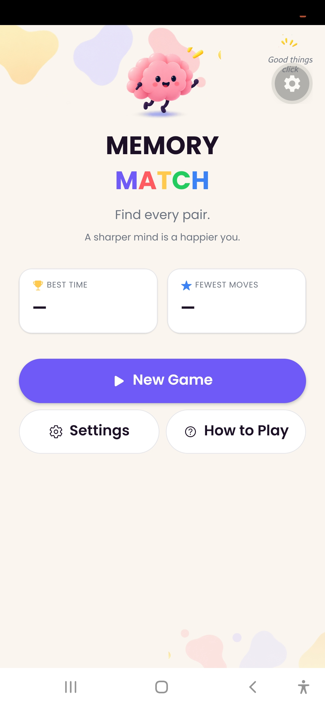
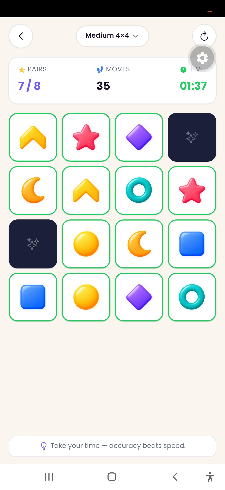
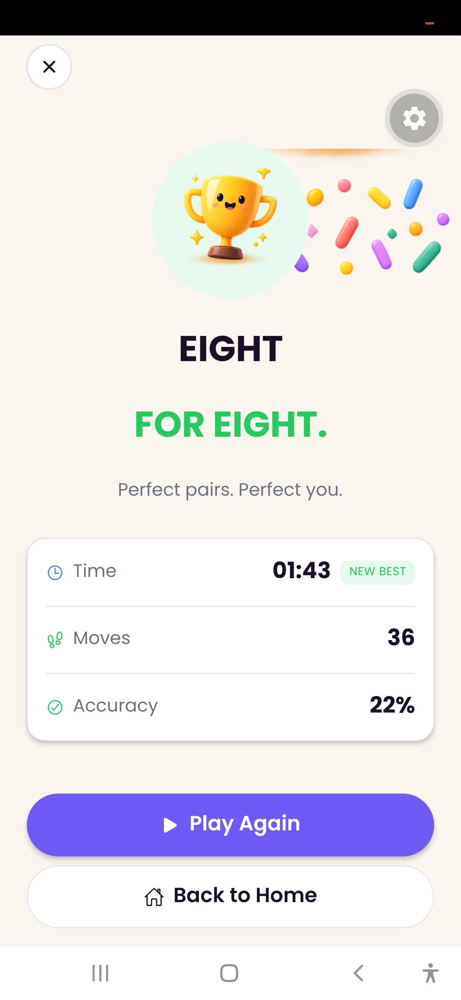
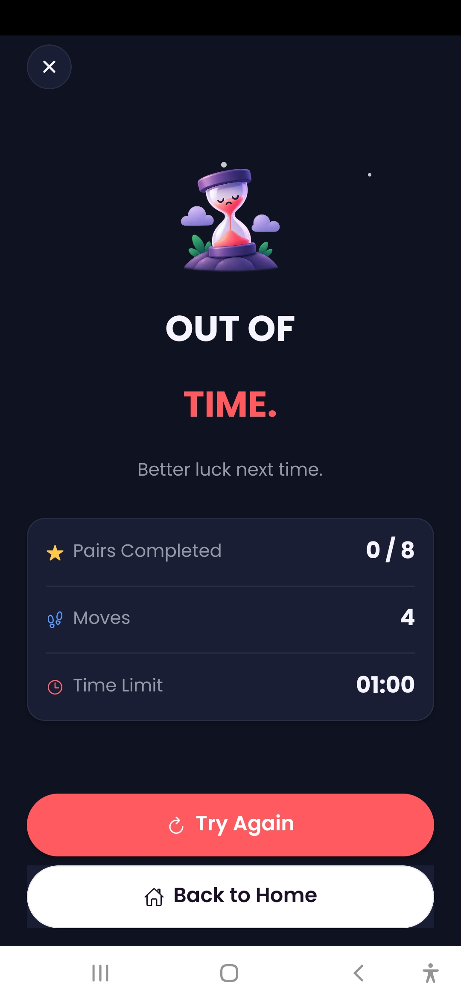
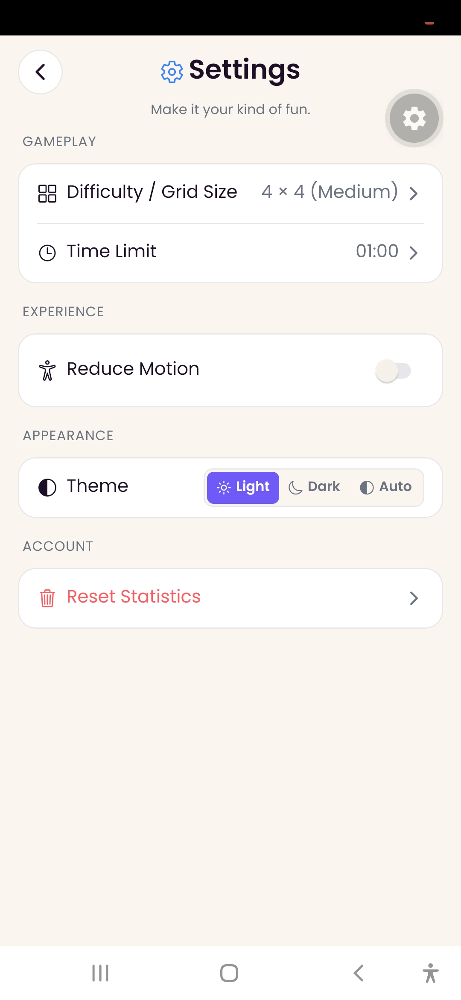

# Memory Match

A polished, casual memory-matching card game built with React Native and Expo, as a take-home engineering exercise. Find every pair before the clock — or the optional time limit — runs out.

<p align="center">
  
  
  
</p>

## Overview

Memory Match is a 4×N tile-matching game: tap two cards, and if their symbols match they stay face up; if not, they flip back down. Match every pair to win. The project was built in deliberately incremental phases — pure game logic first (fully unit-tested, with zero UI or React Native dependency), then a hook layer wiring that logic into React state and timing, then the UI, then a visual-fidelity pass against a supplied design reference. That phase history is why the architecture keeps game rules, state management, and presentation in three cleanly separated layers rather than one another.

## Features

- 4×4 "Medium" board by default, with **Easy** (4×3, 6 pairs) and **Hard** (4×6, 12 pairs) difficulty presets, switchable from the Home/Settings screens or live from the in-game header
- Optional **time limit** (Off / 60s / 90s / 120s / 180s) — run out of time before finding every pair and the game ends in a dedicated Time Up screen instead of a win
- Real 3D card-flip animation (Reanimated), match "pop," and mismatch "shake," all with a working **Reduce Motion** setting that swaps transform-based animation for a near-instant, opacity-only transition
- Move counter, live timer (counts down when a time limit is set, up otherwise), and pairs-found tracker
- Session best-time / fewest-moves tracking per difficulty, shown on Home and flagged with a "NEW BEST" badge on the Win screen
- Light / Dark / Auto (follows the OS) theming, built on a small design-token system (colors, typography, spacing, radii, shadows)
- Fully responsive board and layout — card size is computed from the device's actual available width at runtime, not hard-coded per device

## Tech stack

| Layer | Choice | Why |
|---|---|---|
| Framework | Expo (managed) + React Native 0.86, React 19 | No native build tooling required for day-to-day development; `eas build` can still produce a real installable APK/AAB when needed |
| Language | TypeScript (strict) | Game logic and UI both benefit from typed state, especially around the game's discriminated `CardState`/`GameStatus` unions |
| Navigation | `@react-navigation/native-stack` | Standard, minimal native-stack navigator for 5 screens — no file-based routing convention needed for a project this size |
| Animation | `react-native-reanimated` | UI-thread-driven flip/pop/shake animation |
| Icons | `@expo/vector-icons` (Ionicons) | Consistent outline icon set for chrome (back/settings/sound/lock/etc.), already bundled with Expo — no extra native linking |
| Font | `@expo-google-fonts/poppins` | The supplied design reference specifies Poppins by name |
| Testing | Jest (`jest-expo` preset) + `@testing-library/react-native` | Unit tests for game logic/hooks, no snapshot/UI regression suite |
| State | Plain React state/`useReducer` + two small Context providers | No Redux/Zustand — the app has no state complex enough to justify one (see Architecture) |

No backend, no analytics, no ads, no in-app purchases, no persistence layer (see **Known Limitations**).

## Architecture

```
src/
  game/        Pure game rules — zero React/React Native imports
    types.ts     Card, CardState, GameState, GameStatus
    deck.ts      generateDeck(pairCount): shuffles a deck; SYMBOLS is the single
                 place mapping a card's identity to what it displays
    match.ts     createGame, selectCard, resolveMismatch, restartGame — the
                 entire rules engine as pure functions on GameState
  hooks/
    useGame.ts        Wraps game/ in React state; owns the mismatch-flip timer,
                       the difficulty-change reshuffle, and the optional
                       time-limit countdown — none of which game/ knows about
    useGameSettings.tsx  Context for difficulty, time limit, and session best-
                          results (React state only — see Known Limitations)
    useTimer.ts       A generic elapsed-seconds stopwatch, no game knowledge
  theme/        Design tokens: colors (light/dark), typography (Poppins scale),
                spacing, radii, shadows, animation durations, ThemeContext
                (light/dark/auto), and gameAssets.ts (the one place that maps
                a card's symbol id to its artwork file)
  components/   Presentational building blocks (AppButton, MemoryCard, GameBoard,
                StatsBar, GameHeader, ResultScreen, SettingRow, Toggle) plus
                illustrations/Mascot.tsx
  screens/      HomeScreen, GameScreen, WinScreen, TimeUpScreen, SettingsScreen
  navigation/   RootNavigator.tsx — typed 5-route native-stack
  types/        Shared navigation param types
  utils/        formatTime, numberToWords (both pure, presentation-only)
  services/     Reserved for a future persistence layer (currently empty)
```

**Why no Redux/Zustand:** the entire game state lives in one `useGame()` call inside `GameScreen`; nothing about it is shared across disconnected components or needs time-travel debugging. `useGameSettings` and `ThemeContext` use plain Context + `useState` for the same reason — each holds a handful of primitive values with no complex derived state.

**Why the pure/hook/UI split matters in practice:** `src/game/` has no dependency on React at all, so `deck.ts` and `match.ts` are tested by calling plain functions and asserting on plain objects — no rendering, no mocking. `useGame.ts` is the only place that knows about timers, animation-adjacent delays, or React state; `match.ts` and `deck.ts` were never modified after Phase 2 despite five subsequent phases of hook, UI, and visual-fidelity work on top of them.

## Game rules

- The board is dealt as `pairCount` matching pairs, shuffled (Fisher–Yates); every card starts hidden.
- Tapping a hidden card flips it face up.
- When two cards are face up: if their symbols match, both become permanently `matched` (green border); if not, both stay face up briefly (red border, subtle shake), then flip back to hidden after ~700ms.
- While two cards are face up and unresolved, every other card is locked (visibly dimmed with a lock glyph) — a third tap does nothing until the pair resolves.
- **Moves** increments once per completed pair-comparison (not per individual tap).
- **Win:** every pair is matched. Shows time, moves, and accuracy (`matchedPairs / moves`, rounded).
- **Time Up:** if a time limit is configured and it elapses before the board is fully matched, the game ends immediately — no further taps are accepted — and shows pairs completed, moves, and the configured limit.
- **Restart** deals an entirely fresh shuffled board with the same difficulty/time-limit settings; moves, matched pairs, and the timer all reset.

## Difficulty levels

| Difficulty | Grid | Pairs | Cards |
|---|---|---|---|
| Easy | 4 × 3 | 6 | 12 |
| Medium (default) | 4 × 4 | 8 | 16 |
| Hard | 4 × 6 | 12 | 24 |

All three share the same 4-column layout, so only row count (and therefore pair count) changes — the responsive column-width math in `GameBoard` doesn't need to branch per difficulty.

## Asset / design implementation

The visual design was built against a supplied reference (`assets/design-reference/`) in several passes: an initial token-based implementation, then a full swap to the actual generated artwork once it was supplied (`assets/game/`), then two rounds of device-screenshot-driven layout correction (`assets/device-screenshots/`).

- **Card symbols** (`assets/game/symbols/*.png`) are mapped 1:1 to the 12 internal symbol IDs in `src/theme/gameAssets.ts` — `deck.ts`'s own symbol values were never changed to make this work; only how they're *rendered* changed.
- **Mascot illustrations** (`assets/game/mascots/*.png` — brain/trophy/hourglass) render through `components/illustrations/Mascot.tsx`, which exposes a stable `variant`/`size` API so the artwork can be swapped again later without touching any screen.
- **Decorative assets** (`assets/game/decoration/*.png`) are used selectively — background blobs on Home, a confetti burst on Win — where they visibly correspond to the reference; a few supplied decoration files (clouds, plants, sparkles) aren't currently placed anywhere, since the mascot artwork already bakes in equivalent decoration (see Known Limitations).
- **Typography, color, spacing, radii, and shadow tokens** in `src/theme/` were derived directly from the reference's design-system sheet.

## Testing

Unit tests cover the two layers that are pure/hook logic — no component or screen tests exist (see Known Limitations).

```
src/game/deck.test.ts    7 tests  — deck size, pair counts, symbol duplication,
                                    unique ids, shuffle determinism, mutation-
                                    free generation, out-of-symbols guard
src/game/match.test.ts  12 tests  — flip/match/mismatch/win/restart transitions,
                                    every documented no-op case (already
                                    matched, same card twice, third tap while
                                    locked, unknown id, post-win input)
src/hooks/useTimer.test.ts  5 tests — start/stop/reset/unmount-cleanup
src/hooks/useGame.test.ts  15 tests — match continuation after a match, mismatch
                                      timing via fake timers, time-limit end
                                      state, restart mid-mismatch race, and
                                      difficulty (pairCount) changes mid-session
```

Run everything:

```bash
npm test
```

39 tests, 4 suites, all passing as of this audit.

**Manual testing** was done by installing and playing the app on a real Android device across every phase (see the commit history / phase reports for the checklist used); there is no automated end-to-end or component-rendering test suite.

## Run instructions

```bash
npm install
npm start        # or: npx expo start
```

Scan the QR code with **Expo Go** on your own Android or iOS device, or press `a`/`i` in the terminal for an emulator/simulator. Every dependency in this project is Expo-Go-compatible — no custom development client is required.

Type-check and lint-equivalent check:

```bash
npx tsc --noEmit
```

## Build instructions

This is a managed Expo project — production builds go through EAS Build rather than a local Android Studio/Xcode setup (useful if you're not on a Mac, or don't want to install the native toolchains just to produce an installable build):

```bash
npm install -g eas-cli
eas login
eas build --platform android --profile preview   # installable APK, no Play Store needed
eas build --platform android --profile production # AAB, for Play Store submission
eas build --platform ios --profile preview         # requires an Apple Developer account
```

(An `eas.json` build-profile file is not yet included in this repo — add one with `eas build:configure` before running the above.)

## Screenshots

| Home | Gameplay | Win | Time Up | Settings |
|---|---|---|---|---|
|  |  |  |  |  |

All captured on a real Android device. The visual design target these were built against is in `assets/design-reference/`.

